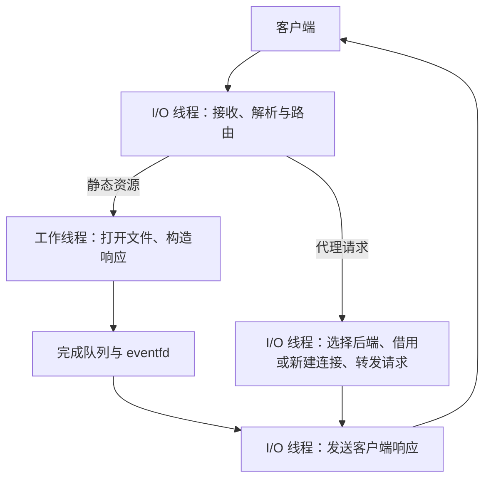

# TinyHttpServer

基于 C++20 和 Linux 实现的 HTTP 服务器，支持静态资源服务和多后端反向代理。代理支持轮询负载均衡、故障冷却、两侧 HTTP/1.1 连接复用，以及 POST 转发和 chunked 解码。

采用单 Reactor + 工作线程池架构：I/O 线程通过 epoll 管理客户端与后端连接，工作线程处理静态文件请求，异步日志线程负责日志写入。

## 功能

### HTTP 静态资源服务

- 解析 HTTP/1.0、HTTP/1.1 请求行和请求头，支持定长正文及 HTTP/1.1 的 chunked 正文。
- 静态资源支持 GET、HEAD、Keep-Alive、默认首页和 MIME 类型识别。
- 使用 `sendfile` 发送静态文件正文，记录文件偏移和剩余长度，处理部分发送。
- 同一客户端连接内串行处理请求，当前响应结束后继续处理已缓存的请求。
- 校验请求头和正文字节数，限制分块格式开销。
- 工作线程池采用有界任务队列，排队任务达到上限时返回 `503`。

### 多后端反向代理与负载均衡

- 根据最长路径前缀匹配 `location`，支持 GET、HEAD、POST，保留原请求路径和查询参数。
- 按轮询顺序选择后端，跳过冷却中或连接占满的节点。
- 客户端使用 HTTP/1.1 时支持 Keep-Alive。代理也通过 HTTP/1.1 连接后端，并按后端地址维护连接池。
- 接收定长或 chunked 请求，按实际正文长度转发；支持 `Expect: 100-continue`。
- 接收定长、chunked 和以断开连接结束的响应，单独处理 HEAD、`204`、`304` 等无正文响应。
- 重写 `Host`，过滤逐跳头字段，保留多条 `Set-Cookie` 等重复响应头。
- 后端连接、传输或响应格式错误返回 `502`，后端交互超时返回 `504`，无可选后端时返回 `503`。

### 网络与连接管理

- 使用非阻塞 Socket 和 epoll ET 处理网络事件。
- 发送遇到 EAGAIN 时保存进度，等待后续可写事件继续发送。
- 使用完成队列和 eventfd 将工作线程结果交回 I/O 线程。
- 使用 fd + connection_id 校验工作线程结果与客户端连接的对应关系。
- 分别处理后端交互超时、客户端发送超时和客户端空闲超时。
- 使用 signalfd 接收 SIGINT、SIGTERM，并有序释放线程、连接和文件描述符。
- 客户端 Socket 开启 TCP_NODELAY。

## 技术栈

C++20、Linux Socket、epoll、eventfd、signalfd、sendfile、TCP_NODELAY、std::thread、mutex、condition_variable、CMake。

## 编译与运行

### 环境

- Linux 或 WSL2。
- 支持 C++20 的 GCC / Clang。
- CMake 3.16 及以上。
- curl 用于访问服务，Python 3 可用于启动示例后端。

### 编译

```bash
git clone https://github.com/zheng-jiu/http_server.git
cd http_server

cmake -S . -B build -DCMAKE_BUILD_TYPE=Debug
cmake --build build -j4
```

### 启动 HTTP 服务器

在仓库根目录执行：

```bash
./build/tiny_httpd
```

默认读取 `tiny_httpd.conf`，监听 `0.0.0.0:8080`，静态资源目录为 `www/`。

访问首页：

```bash
curl --noproxy '*' -i http://127.0.0.1:8080/
```

通过位置参数覆盖端口、静态资源目录和工作线程数：

```bash
./build/tiny_httpd 8081 www 4
```

通过 `-c` 指定配置文件：

```bash
./build/tiny_httpd -c tiny_httpd.conf
```

配置文件与位置参数可以组合使用，位置参数优先：

```bash
./build/tiny_httpd -c custom.conf 8082 ./public 8
```

相对路径以进程启动时的工作目录为基准。前台运行时按 `Ctrl+C` 停止服务器。

## 配置

`tiny_httpd.conf` 示例：

```nginx
server {
    listen 8080;
    root "www";

    worker_threads 4;
    keep_alive 15;
    max_events 1024;

    log_path "tiny_httpd.log";

    max_body_size 1048576;
    max_pending_tasks 256;
    send_timeout 15;

    location /api/ {
        proxy_pass "http://127.0.0.1:9001";
        proxy_pass "http://127.0.0.1:9002";
    }
}
```

### 已接入运行流程的配置

| 配置项 | 默认值 | 作用 |
| --- | --- | --- |
| `listen` | `8080` | HTTP 监听端口 |
| `root` | `www` | 静态资源根目录 |
| `worker_threads` | `4` | 静态请求工作线程数 |
| `keep_alive` | `15` | 客户端空闲超时，单位为秒 |
| `max_events` | `1024` | 单次 epoll_wait 最多接收的就绪事件记录数 |
| `log_path` | `tiny_httpd.log` | 日志文件路径 |
| `max_body_size` | `1048576` | 请求体大小上限，单位为字节 |
| `max_pending_tasks` | `256` | 工作线程池最大排队任务数 |
| `send_timeout` | `15` | 向客户端发送时连续无进展的超时秒数 |
| `location` | 空 | 按请求路径匹配规则 |
| `proxy_pass` | 空 | 后端地址；同一 location 内可重复配置多个地址，按轮询顺序选择 |

配置解析器还保留了 `log_level`、`rate_limit`、`server_name`、location 内的 `root` 和 `expires` 语法，这些字段目前仅完成解析，对应功能尚未接入运行流程。

### 代理路由规则

匹配时使用去掉查询参数后的请求路径，多条规则同时匹配时选择路径最长的一条。

例如，同时存在 `/api/` 和 `/api/admin/` 时，`/api/admin/users` 选择 `/api/admin/`。

转发时保留完整的原请求路径和查询参数：

| 客户端请求 | 后端收到的请求路径 |
| --- | --- |
| `/api/users` | `/api/users` |
| `/api/users?page=1` | `/api/users?page=1` |

后端地址采用以下格式：

```text
http://IPv4:端口
```

例如：

```text
http://127.0.0.1:9001
```

地址显式填写端口，端口后省略路径和末尾斜杠。

## 反向代理运行示例

本示例使用两个后端，分别监听 9001、9002，由 TinyHttpServer 在 8080 端口统一接收请求。

确认配置中的 `/api/` 规则包含以下两个地址：

```nginx
location /api/ {
    proxy_pass "http://127.0.0.1:9001";
    proxy_pass "http://127.0.0.1:9002";
}
```

同一 location 内重复填写 proxy_pass，可以添加多个后端。配置修改后重启 TinyHttpServer 生效。

### 启动两个后端

终端 1：准备并启动后端 A。

```bash
mkdir -p /tmp/tiny-http-backend-a/api

printf 'A' > /tmp/tiny-http-backend-a/api/node.txt

python3 -m http.server 9001 \
    --bind 127.0.0.1 \
    --directory /tmp/tiny-http-backend-a
```

终端 2：准备并启动后端 B。

```bash
mkdir -p /tmp/tiny-http-backend-b/api

printf 'B' > /tmp/tiny-http-backend-b/api/node.txt

python3 -m http.server 9002 \
    --bind 127.0.0.1 \
    --directory /tmp/tiny-http-backend-b
```

### 启动代理并访问

终端 3：在仓库根目录启动 TinyHttpServer。

```bash
./build/tiny_httpd -c tiny_httpd.conf
```

终端 4：连续发送四个请求。

```bash
for i in 1 2 3 4; do
    printf '第 %s 次：' "$i"
    curl --noproxy '*' -sS --max-time 20 \
        -w ' HTTP %{http_code}\n' \
        http://127.0.0.1:8080/api/node.txt
done
```

刚启动代理且按上述顺序请求时，输出如下：

```text
第 1 次：A HTTP 200
第 2 次：B HTTP 200
第 3 次：A HTTP 200
第 4 次：B HTTP 200
```

### 观察故障摘除与恢复

1. 在终端 1 按 Ctrl+C，停止后端 A。
2. 在终端 4 再次执行四次请求命令。第一次选中 A 的请求返回 502，之后在冷却期间请求交给 B。
3. 在终端 1 重新执行后端 A 的启动命令。
4. 在终端 4 执行 `sleep 11`，等待冷却结束，再次发送请求，观察 A、B 恢复交替返回。

停止两个后端后，访问各节点的请求会分别触发 502 并记录冷却。当两个节点都处于冷却状态时，新请求返回 503。

### 验证 POST、chunked 与连接复用

在 `tiny_httpd.conf` 的 `server` 内添加以下规则，与原有的 `location /api/` 并列，然后重启代理。`/api/echo` 会命中更长的路径前缀。

```nginx
location /api/echo {
    proxy_pass "http://127.0.0.1:9003";
}
```

另开终端启动回显后端。它读取代理发来的定长正文，再以 chunked 格式回显：

```bash
python3 - <<'PY'
from http.server import BaseHTTPRequestHandler, ThreadingHTTPServer

class Echo(BaseHTTPRequestHandler):
    protocol_version = "HTTP/1.1"

    def do_POST(self):
        if self.path != "/api/echo":
            self.send_error(404)
            return

        body = self.rfile.read(int(self.headers["Content-Length"]))
        self.send_response(200)
        self.send_header("X-Echo-Method", self.command)
        self.send_header("X-Upstream-Port", str(self.client_address[1]))
        self.send_header("Transfer-Encoding", "chunked")
        self.end_headers()
        if body:
            self.wfile.write(f"{len(body):X}\r\n".encode() + body + b"\r\n")
        self.wfile.write(b"0\r\n\r\n")

ThreadingHTTPServer(("127.0.0.1", 9003), Echo).serve_forever()
PY
```

在同一个 curl 命令中依次发送定长 POST 和分块 POST：

```bash
url=http://127.0.0.1:8080/api/echo

curl --noproxy '*' --http1.1 -i -w '\n' --data-binary 'hello' "$url" \
    --next --noproxy '*' --http1.1 -i -w '\n' \
    -H 'Transfer-Encoding: chunked' --data-binary 'hello' "$url"
```

两次都应返回 `200 OK`、`X-Echo-Method: POST`、`Content-Length: 5`，正文为 `hello`。这说明两种 POST 都转发到了后端，后端的 chunked 响应也被解码成了定长响应。两次响应中的 `X-Upstream-Port` 相同，说明代理复用了到这个后端的 TCP 连接。需要观察客户端到代理这一侧的复用时，可以给 curl 加 `-v`。

本地静态资源只允许 GET 和 HEAD；向 `/` 发送 POST 会返回 `405`。

### 访问静态资源

静态首页继续使用相同入口：

```bash
curl --noproxy '*' -i http://127.0.0.1:8080/
```

请求 `/api/node.txt` 时，由选中的后端提供内容；请求 `/` 时，由 TinyHttpServer 提供本地静态首页。

## 架构与请求流程



### 静态文件请求

1. I/O 线程接收数据，解析出一个完整请求。
2. 请求交给工作线程，客户端连接标记为处理中。
3. 工作线程完成路径检查、open、fstat 和响应头构造。
4. 工作线程把结果放入完成队列，通过 eventfd 通知 I/O 线程。
5. I/O 线程校验 fd 和 connection_id，接管响应与文件描述符。
6. 先使用 send 发送响应头，再使用 sendfile 发送文件正文。
7. 响应完成后，根据连接状态关闭连接或继续处理下一请求。

Connection 保存文件描述符、文件偏移和剩余长度。发送遇到 EAGAIN 时保留这些状态，后续可写事件到来后继续传输。

### 代理请求

1. I/O 线程解析并收齐请求，按最长路径前缀匹配 `location`。如果 HTTP/1.1 客户端请求 `100-continue` 且正文尚未收齐，代理先发 `100 Continue`，再继续读取；不支持的 `Expect` 返回 `417`。
2. 轮询选择后端，优先借用该地址的空闲连接，池中没有可用连接时新建非阻塞 Socket。连接处于 `EINPROGRESS` 时，通过 `SO_ERROR` 读取连接结果。
3. 向后端发送 HTTP/1.1 请求，保留请求方法、路径和查询参数，重写 `Host`。分块请求先解码，再按解码后的实际长度生成 `Content-Length`。
4. 收齐后端响应后，过滤逐跳头字段。分块响应解码后按实际正文长度返回客户端。后端连接符合复用条件时归池，其余情况关闭。
5. 客户端响应发完后，HTTP/1.1 连接按 `Connection` 决定是否继续保持。同一连接上的下一条请求等本次响应发完再处理。

代理采用整包缓冲：收齐请求再发给后端，收齐响应再发给客户端。请求和响应都支持单一的 `Transfer-Encoding: chunked`，分块尾部字段读取后丢弃。同时声明 `Transfer-Encoding` 和 `Content-Length` 时，请求返回 `400`，后端响应返回 `502`。

### 后端连接池、轮询与故障恢复

- 每条 `location` 独立维护轮询位置；引用同一后端地址的规则共享连接池和冷却状态。
- 每个后端最多保留 16 条连接，含正在建连、处理请求和池中空闲的连接。空闲连接可跨客户端复用，15 秒后回收。
- 轮询跳过冷却中的节点和连接全部占满的节点。没有可选后端时返回 `503`。
- 连接或传输故障返回 `502`，后端交互超时返回 `504`。节点被标记为故障后冷却 10 秒，并清理该节点的空闲连接。冷却到期后，由下一次选中该节点的请求尝试恢复。
- 发现空闲 Socket 已失效时，关闭该 Socket，再取下一条连接或新建连接。复用连接在开始收发时失效，也可以只淘汰该 Socket，保留节点可用状态。
- 后端返回格式有效且完整的 HTTP `4xx`、`5xx` 响应时，代理正常转发。本次请求失败后不自动重发，避免重复执行 POST。

轮询位置、冷却状态和连接池都由 I/O 线程维护。

### 后端响应结束条件

| 响应类型 | 完成条件 |
| --- | --- |
| HEAD 请求的响应、`204`、`304` | 收齐响应头 |
| 定长响应 | 正文收到 `Content-Length` 声明的字节数 |
| chunked 响应 | 读到零长度块，并收完尾部字段和最后的空行 |
| 无长度且非分块的响应 | 后端关闭发送方向，`recv()` 返回 `0` |

定长或分块响应提前断开时返回 `502`。前三类响应收齐后，只要后端是 HTTP/1.1、允许 Keep-Alive 且连接仍可用，就能归池。以断开连接结束的响应按实际收到的长度返回客户端。

### 线程职责

| 线程 | 职责 |
| --- | --- |
| 主 I/O 线程 | epoll 事件循环、客户端与后端 Socket、连接状态、网络收发和超时清理 |
| 工作线程池 | 静态文件请求处理，默认 4 个线程 |
| 日志线程 | 异步写入日志文件 |

Connection 和 Upstream 由 I/O 线程维护。工作线程通过 ResponseResult 交回结果，避免跨线程修改连接状态。

## 超时与资源限制

### 连接与发送超时

| 类型 | 默认值 | 计时范围 | 超时处理 |
| --- | --- | --- | --- |
| 后端交互超时 | 15 秒 | 获取后端连接、发送请求、接收完整响应 | 关闭后端连接、将节点冷却 10 秒并返回 `504` |
| 客户端发送超时 | 15 秒 | 向客户端发送响应时连续无进展的时间 | 关闭客户端连接 |
| 客户端空闲超时 | 15 秒 | 客户端连接未在处理请求且无收发活动的时间 | 关闭客户端连接 |
| 后端池空闲超时 | 15 秒 | 后端连接从归池起的空闲时间 | 关闭并移出连接池 |

客户端发送和空闲超时分别由 `send_timeout`、`keep_alive` 配置。后端交互和池内空闲超时分别由 `proxy_timeout_ms_`、`backend_idle_timeout_ms_` 控制。

### 大小与队列限制

| 项目 | 默认限制 | 超限处理 |
| --- | --- | --- |
| 客户端请求头 | 8 KiB，包含请求行、头字段和结束空行 | 返回 `400` 后关闭连接 |
| 客户端请求正文 | 1 MiB，由 `max_body_size` 配置，chunked 按解码后大小计算 | 返回 `400` 后关闭连接 |
| 客户端输入缓冲区 | `max_body_size` + 8 KiB 请求头 + 64 KiB 分块开销 | 关闭客户端连接 |
| 后端响应头 | 8 KiB，包含状态行、头字段和结束空行 | 返回 `502` |
| 后端响应正文 | 8 MiB，chunked 按解码后大小计算 | 返回 `502` |
| 分块格式开销 | 每条请求或响应 64 KiB，包含块长度行、分隔符和尾部字段 | 请求返回 `400`，响应返回 `502` |
| 工作线程池排队任务 | 256，由 `max_pending_tasks` 配置 | 返回 `503` |
| 每个后端的连接数 | 16，使用中和池内空闲连接合计 | 跳过占满的节点；无可选后端时返回 `503` |

输入缓冲区上限会在解析之前检查，先触及该上限时直接关闭客户端连接。

### 资源释放

- 静态文件发送完成后释放文件描述符。工作线程返回结果时，如果客户端已经断开，也释放结果携带的文件描述符。
- 后端响应收齐后，移除本次请求的 `Upstream` 状态。满足复用条件的 Socket 归池，其余 Socket 关闭。
- 客户端断开时，关闭仍绑定在本次请求上的后端连接；已经归池的连接可继续服务其他客户端。
- 收到 `SIGINT` 或 `SIGTERM` 后，退出事件循环，停止工作线程，清理活跃连接、空闲连接池及文件资源，最后停止日志线程。

## 主要文件

| 路径 | 作用 |
| --- | --- |
| `src/main.cpp` | 程序入口、配置加载和信号设置 |
| `src/linux_server.cpp` | epoll 事件循环、客户端收发、静态请求处理和连接清理 |
| `src/http_proxy.cpp` | 后端轮询、故障冷却、连接池、请求转发和响应解析 |
| `src/http_parser.cpp` | HTTP 请求解析、正文长度校验和分块解码接入 |
| `include/tiny_http/chunk_decoder.h` | 请求与响应共用的 chunked 解码器，支持跨多次接收保存解析进度 |
| `src/http_response.cpp` | HTTP 响应生成 |
| `src/config_parser.cpp` | 配置文件解析和命令行参数覆盖 |
| `src/thread_pool.cpp` | 工作线程池 |
| `src/async_logger.cpp` | 异步日志 |
| `src/mime_types.cpp` | 文件扩展名与 MIME 类型映射 |
| `include/tiny_http/` | HTTP 服务器相关声明和队列实现 |
| `tests/` | 模块测试 |
| `www/` | 静态资源目录 |
| `tiny_httpd.conf` | HTTP 服务器配置 |
| `CMakeLists.txt` | 构建配置 |

## 静态文件性能记录

以下为 sendfile + TCP_NODELAY 调优阶段保留的静态文件历史测量结果。

### 测量环境

| 项目 | 设置 |
| --- | --- |
| 系统环境 | VMware Ubuntu 虚拟机 |
| 可用逻辑 CPU | 4 |
| 工作线程数 | 4 |
| 压测工具 | wrk debian/4.1.0-4build2 |
| 压测线程 | 4 |
| 并发连接 | 100 |
| 单轮时长 | 30 秒 |
| 访问地址 | 127.0.0.1:8080 |

服务端和 wrk 位于同一虚拟机，使用回环网络。数据包含页缓存、回环传输和虚拟机调度的影响。

### 历史结果

表中记录为最初基线与一组完整优化后复测结果。

| 文件大小 | 版本 | Requests/sec | 平均延迟 | P99 |
| --- | --- | ---: | ---: | ---: |
| 4 KiB | 优化前 | 65,542.88 | 1.52 ms | 3.65 ms |
| 4 KiB | sendfile + TCP_NODELAY | 60,788.03 | 1.64 ms | 2.97 ms |
| 100 KiB | 优化前 | 24,467.31 | 3.99 ms | 10.02 ms |
| 100 KiB | sendfile + TCP_NODELAY | 35,012.17 | 2.78 ms | 6.59 ms |
| 1 MiB | 优化前 | 3,302.45 | 29.79 ms | 45.37 ms |
| 1 MiB | sendfile + TCP_NODELAY | 10,745.17 | 7.43 ms | 14.70 ms |

- 4 KiB 请求吞吐下降约 7.3%，P99 从 3.65 ms 降至 2.97 ms。
- 100 KiB 请求吞吐提升约 43.1%。
- 1 MiB 请求吞吐达到基线约 3.25 倍，平均延迟从 29.79 ms 降至 7.43 ms。

采用 sendfile 后，文件正文直接从文件描述符发送到客户端 Socket，省去将整个文件正文组装进用户态 HTTP 响应字符串的步骤。

发送调整为“send 响应头 + sendfile 正文”时，小文件场景曾出现约 41 ms 的平均延迟；开启 TCP_NODELAY 后，记录到的平均延迟恢复至约 1.6～1.8 ms。

### 压测命令示例

创建一个 1 MiB 静态文件：

```bash
dd if=/dev/zero of=www/bench_1m.bin bs=1M count=1
```

保持服务器运行，在另一个终端执行：

```bash
wrk -t4 -c100 -d30s --latency \
    http://127.0.0.1:8080/bench_1m.bin
```

## 模块测试

完成 Debug 构建后执行：

```bash
ctest --test-dir build --output-on-failure
```

现有测试目标：

| 目标 | 内容 |
| --- | --- |
| `parser_tests` | HTTP 请求解析、请求体解析、MIME 查询和响应序列化 |
| `config_parser_tests` | 配置语法、默认值和命令行参数覆盖 |
| `room_protocol_tests` | TCP 房间协议编解码及消息边界处理 |

## 附属 TCP 程序

仓库还包含独立的 `tiny_roomd`，用于 TCP 长连接、消息回显和房间广播练习。

```bash
./build/tiny_roomd
```

默认监听 `127.0.0.1:9090`，使用自定义二进制协议。实现位于 `src/room_server.cpp`，协议定义位于 `include/tiny_room/protocol.h`。